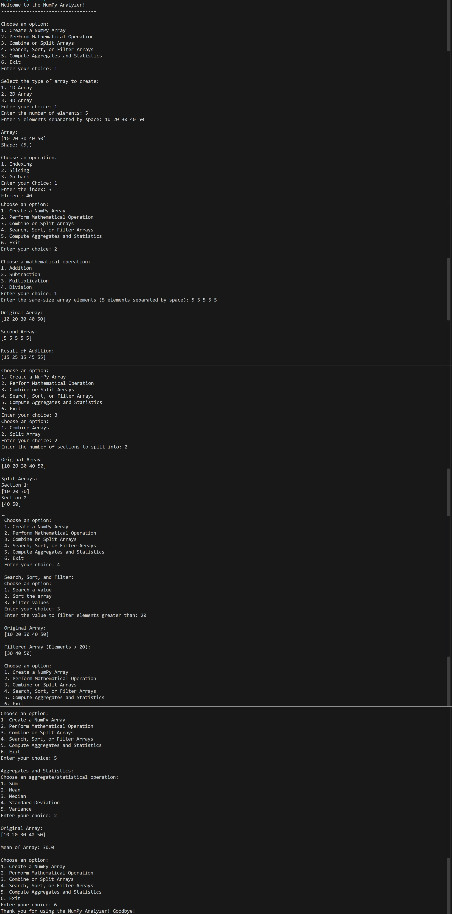

# 🚀 NumPy Analyzer — Python Data Analysis Project

<p align="center">
  
</p>

<h2 align="center">📊 Analyze • Calculate • Explore</h2>

<p align="center">
  A Menu-Driven Python Project for NumPy Array Operations and Numerical Analysis
</p>

<p align="center">
  
  
  
  
  
</p>

---

## 📌 About the Project

**NumPy Analyzer** is a menu-driven Python application developed to explore the power of NumPy for numerical computing and array-based data analysis.

The project provides a simple, interactive console interface through which users can create NumPy arrays, access individual elements, extract portions of arrays, perform mathematical calculations, combine and split arrays, search for specific values, sort elements, filter data, and calculate statistical measurements.

Instead of performing every operation manually, users can select options from the main menu and perform different operations step by step.

This project demonstrates the practical application of Python programming concepts and NumPy functions while building a foundation for more advanced topics in data analysis, scientific computing, and machine learning.

## 🎯 Project Objectives

The main objectives of this project are:

- To understand the fundamentals of NumPy arrays.
- To create and manipulate one-dimensional, two-dimensional, and three-dimensional arrays.
- To understand array indexing and slicing.
- To perform element-wise mathematical operations.
- To learn how arrays can be combined and divided into smaller sections.
- To search for values and identify their positions.
- To sort array elements and filter data based on conditions.
- To calculate important statistical measurements.
- To apply Python classes, methods, conditional statements, loops, and user input in a practical project.
- To improve problem-solving and logical-thinking skills.
- To develop a foundation for future data analytics and machine learning projects.

## ✨ Key Features

### 1. 🧮 NumPy Array Creation

Create arrays of different dimensions according to your requirements.

**Supported array types:**
- 1D Array — A one-dimensional sequence of elements.
- 2D Array — A two-dimensional arrangement of rows and columns.
- 3D Array — A three-dimensional arrangement of depth, rows, and columns.

**Additional functionality:**
- Enter array dimensions through user input.
- Enter elements dynamically.
- Validate the number of elements entered.
- Reshape the elements into the selected dimensions.
- Display the created array.
- Display the shape of the array.

### 2. 🔍 Array Indexing

Access individual elements from an array using their index positions.

The project supports indexing for:

- 1D arrays using a single index.
- 2D arrays using row and column indices.
- 3D arrays using depth, row, and column indices.

Indexing helps users understand how individual values can be accessed within arrays of different dimensions.

### 3. ✂️ Array Slicing

Extract a selected portion of an array using slicing.

**Supported operations:**
- Slice a 1D array using a start and end index.
- Extract selected rows and columns from a 2D array.
- Extract selected depth, row, and column ranges from a 3D array.

Slicing is useful when working with only a specific part of a dataset instead of the complete array.

### 4. ➕ Mathematical Operations

Perform mathematical calculations between two NumPy arrays having the same shape.

| Operation | Description |
|---|---|
| Addition | Adds corresponding elements of two arrays. |
| Subtraction | Subtracts corresponding elements of the second array from the first. |
| Multiplication | Multiplies corresponding elements of two arrays. |
| Division | Divides corresponding elements of the first array by the second. |

**Important features:**
- Create a second array with the same dimensions as the original array.
- Display both arrays before showing the result.
- Perform element-wise arithmetic operations.
- Check the number of entered elements.
- Prevent division by zero when any element of the second array is zero.

### 5. 🔗 Combining Arrays

Combine arrays to create a larger array.

The project uses NumPy's `np.vstack()` function to stack two arrays vertically.

**Features:**
- Use the existing array as the first input.
- Enter another array with the same shape.
- Display both original arrays.
- Display the vertically combined result.

Vertical stacking is useful for understanding how multiple arrays can be joined along the row direction.

### 6. ✂️ Splitting Arrays

Divide an array into multiple sections using NumPy's `np.array_split()` function.

**Features:**
- Specify the number of sections.
- Divide the existing array into the requested sections.
- Display the original array.
- Display each resulting section separately.
- Handle exceptions that occur during the splitting operation.

The `np.array_split()` function can produce sections of unequal sizes when the array cannot be divided evenly.

### 7. 🔎 Searching Array Elements

Search for a particular value in an existing array using `np.where()`.

**Features:**
- Enter the value to search for.
- Compare array elements with the specified value.
- Identify the indices where matching elements are found.
- Display the original array and the resulting indices.

This functionality introduces conditional searching in NumPy arrays.

### 8. 📈 Sorting Arrays

Arrange array elements in sorted order using `np.sort()`.

**Features:**
- Sort the elements of the existing array.
- Display the original array.
- Display the sorted result.

For multidimensional arrays, the default `np.sort()` behavior sorts along the last axis. For a 2D array, this means sorting each row independently.

### 9. 🎯 Filtering Array Values

Filter elements based on a specified numerical condition.

The project uses Boolean indexing to select elements greater than a user-provided value.

**Features:**
- Enter a threshold value.
- Compare the array elements against the threshold.
- Select elements satisfying the condition.
- Display the original and filtered arrays.

Filtering is an important operation in data analysis because it helps identify values that meet specific criteria.

### 10. 📊 Aggregate and Statistical Operations

Calculate numerical summaries of the existing array using NumPy functions.

| Function | Purpose |
|---|---|
| `np.sum()` | Calculates the sum of all array elements. |
| `np.mean()` | Calculates the arithmetic mean. |
| `np.median()` | Calculates the median value. |
| `np.std()` | Calculates the standard deviation. |
| `np.var()` | Calculates the variance. |

These operations help summarize numerical data and understand its basic statistical properties.

## 🛠️ Technologies Used

### Python

Python is the main programming language used to develop the application. It provides the program structure, user interaction, conditional logic, loops, and class-based organization.

### NumPy

NumPy is the primary library used for numerical computing. It provides multidimensional arrays and functions for array manipulation, mathematical operations, sorting, searching, and statistics.

### Git and GitHub

Git and GitHub can be used to manage the project source code, track changes, and share the project as part of a programming portfolio.

## 📚 Python and NumPy Concepts Demonstrated

This project brings together several important programming concepts.

**Python concepts:**
- Classes and objects.
- The `__init__()` constructor.
- Instance attributes using `self`.
- User input with `input()`.
- Conditional statements (`if`, `elif`, and `else`).
- Iteration using `for` and `while` loops.
- Methods and function calls.
- Exception handling using `try` and `except`.
- Lists and type conversion.
- The main program entry point using `if __name__ == "__main__":`.

**NumPy concepts:**
- `np.array()`
- `reshape()`
- `shape`
- `size`
- Array indexing.
- Array slicing.
- Element-wise arithmetic.
- `np.any()`
- `np.vstack()`
- `np.array_split()`
- `np.where()`
- `np.sort()`
- Boolean indexing.
- `np.sum()`
- `np.mean()`
- `np.median()`
- `np.std()`
- `np.var()`

## 🗂️ Project Structure

```text
NumPy-Analyzer/
│
├── Numpy_Analyzer.py
├── Numpy_Analyzer.png
└── README.md
```

**File descriptions:**

- `Numpy_Analyzer.py` — Contains the main Python program, `DataAnalytics` class, and menu-driven operations.
- `Numpy_Analyzer.png` — Project image or screenshot.
- `README.md` — Project documentation, features, setup instructions, and usage guide.

## ⚙️ Requirements

Before running the project, make sure you have:

- Python 3.x installed on your system.
- The NumPy library installed.
- A code editor such as Visual Studio Code, or another Python-compatible development environment.
- A terminal or command prompt to run the program.

## 🚀 Installation and Setup

### Step 1: Clone the Repository

Open your terminal and run the following command, replacing the placeholder with your actual GitHub repository URL.

```bash
git clone <your-repository-url>
```

### Step 2: Open the Project Folder

Move into the downloaded project directory.

```bash
cd <project-folder>
```

### Step 3: Install NumPy

Install the required library using pip.

```bash
python -m pip install numpy
```

### Step 4: Verify the Installation

Check whether NumPy is installed correctly.

```bash
python -c "import numpy; print(numpy.__version__)"
```

If the command displays the installed NumPy version, the library is available to that Python environment.

### Step 5: Run the Application

Execute the main Python file.

```bash
python Numpy_Analyzer.py
```

The application will display the welcome message and main menu.

## 🖥️ How to Use the Application

When the program starts, the following main menu is displayed:

```text
Welcome to the NumPy Analyzer!
----------------------------------

Choose an option:
1. Create a NumPy Array
2. Perform Mathematical Operation
3. Combine or Split Arrays
4. Search, Sort, or Filter Arrays
5. Compute Aggregates and Statistics
6. Exit
```

Enter the number corresponding to the operation you want to perform.

### Option 1: Create a NumPy Array

1. Select the array creation option.
2. Choose 1D, 2D, or 3D.
3. Enter the required dimensions.
4. Enter the specified number of integer elements.
5. View the array and its shape.
6. Choose indexing, slicing, or return to the main menu.

### Option 2: Perform Mathematical Operations

1. Create an array first.
2. Select the mathematical operations option.
3. Choose addition, subtraction, multiplication, or division.
4. Enter the elements of a second array with the same shape.
5. View both arrays and the result.

### Option 3: Combine or Split Arrays

1. Create an array first.
2. Select the combine or split option.
3. For combining, enter a second array and view the vertical stack.
4. For splitting, specify the number of sections.
5. View the resulting combined array or individual sections.

### Option 4: Search, Sort, or Filter Arrays

1. Create an array first.
2. Choose the desired operation.
3. For searching, enter a value to locate.
4. For sorting, view the sorted array.
5. For filtering, enter a threshold value.
6. Review the result displayed in the console.

### Option 5: Compute Aggregates and Statistics

1. Create an array first.
2. Select the statistical operation.
3. Choose sum, mean, median, standard deviation, or variance.
4. View the calculated result.

### Option 6: Exit

Select the exit option to terminate the application.

## 🧪 Example Workflow

The following is an illustrative example of creating a 1D array.

**Input:**

```text
Enter your choice: 1
Enter the number of elements: 5
Enter 5 elements separated by space: 10 20 30 40 50
```

**Output:**

```text
Array:
[10 20 30 40 50]

Shape: (5,)
```

The same application can also create 2D and 3D arrays by accepting their respective dimensions and the required number of elements.

## 🧠 Learning Outcomes

Developing this project provides practical experience with:

1. Creating arrays with different dimensions.
2. Understanding array shapes and sizes.
3. Accessing data using indexing and slicing.
4. Applying arithmetic operations to numerical arrays.
5. Understanding vertical stacking and array splitting.
6. Searching for specific values.
7. Sorting numerical data.
8. Filtering data using Boolean conditions.
9. Calculating statistical summaries.
10. Organizing a Python program using a class.
11. Building an interactive console application.
12. Validating user-provided array dimensions and element counts.
13. Handling certain runtime errors using exception handling.
14. Connecting theoretical NumPy concepts with practical programming tasks.

## 🌟 Applications and Future Scope

The concepts demonstrated in NumPy Analyzer are relevant to several areas of computing.

**Potential applications include:**

- Data preprocessing and numerical data manipulation.
- Basic statistical analysis.
- Scientific and mathematical computing.
- Learning multidimensional data structures.
- Building a foundation for data analytics.
- Preparing for more advanced NumPy and pandas projects.
- Understanding numerical operations used in machine learning workflows.

**Possible future enhancements:**

- Add more comprehensive input validation.
- Support floating-point values in array creation.
- Add matrix multiplication and additional mathematical operations.
- Provide horizontal stacking and axis-specific splitting.
- Support sorting along user-selected axes.
- Add minimum, maximum, percentile, and cumulative operations.
- Display the mean and other statistics along selected axes.
- Add more advanced filtering conditions.
- Implement a repeat-operation submenu without returning to the main menu.
- Add unit tests for individual methods.
- Develop a graphical user interface.
- Export analysis results to CSV files.

These are possible improvements for future versions; they are not all implemented in the current project.

## 👩‍💻 Author

**Vishakha Junjiya**

BCA Student | Python Learner | Aspiring Data Scientist

This project is part of my programming practice and learning journey in Python and data analysis.

## 🤝 Contributions

Suggestions and feedback are welcome. If you find an issue or have an idea for improving the project, you can open an issue or propose a change through GitHub.

## 📄 License

This project is intended for learning and educational purposes. You may add an appropriate open-source license to the repository if you want to specify permissions for reuse and distribution.

---

<p align="center">
  <b>Thank you for visiting NumPy Analyzer! 💙</b>
</p>

<p align="center">
  Keep Learning • Keep Practicing • Keep Building 🚀
</p>
